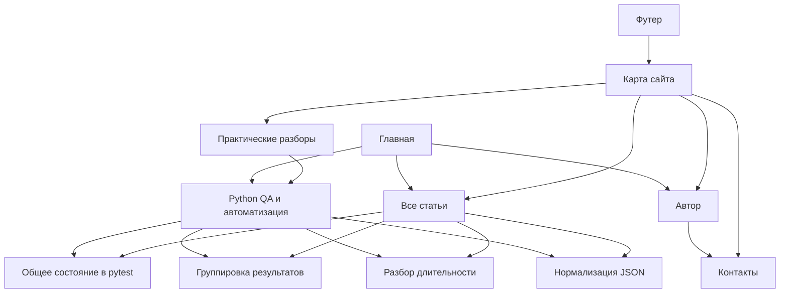

# Все доступные на сегодня страницы сайта — Implementation Plan

> **For agentic workers:** REQUIRED SUB-SKILL: Use superpowers:executing-plans to implement this plan task-by-task. Steps use checkbox (`- [ ]`) syntax for tracking. Рекомендуемый способ — последовательное исполнение в текущем чате; делегирование отдельно не требуется.

**Goal:** Подготовить все содержательные страницы, для которых на 29.10.2026 найдены материалы, связать их навигацией и передать точные версии на авторскую проверку.

**Architecture:** Сохраняются Hugo/Hextra и существующие URL. Общая лента объединяет статьи блога и Python-раздела через одну коллекцию; разделы помогают выбирать материалы, а статьи содержат сами разборы. Авторские черновики отделены от обычной сборки.

**Tech Stack:** Hugo (локально 0.161.1), Hextra 0.12.3, Go templates, Markdown/YAML, Python для проверок. В deploy-конфигах сейчас Hugo 0.156.0.

**Spec:** [Предварительный анализ структуры](../specs/2026-10-29-site-pages-design.md), актуальный `AGENTS.md` и прямой запрос Дмитрия от 29.10.2026 прочитать новые навыки и составить поэтапный план создания всех возможных сейчас страниц. Предварительный анализ ограничивал объем двумя новыми страницами; этот план расширяет его за счет непосредственно прочитанных учебных исходников. Ни прежнее предложение, ни этот план не объявляются принятыми целиком.

**Статус:** план подготовлен; исполнение этапов не начато. Тесты учебного кода в этой задаче не запускались. Дата — Europe/Saratov. «Можно создать» означает достаточность материала для честного черновика, а не автоматическую готовность к публикации.

**Текущее уточнение исполнения, 29.10.2026:** тексты выдаются по одной странице для авторских правок. Главная, каталог и биографический вариант автора утверждены; P04 ранее также утвержден. При показе P05 Дмитрий указал на дублирование P04: «чем отличается от предыдущей? зачем одно и тоже копировать?». P05 не принят. Предложение ассистента — убрать оба дополнительных публичных входа P04/P05, используя категории и темы общего каталога для технических материалов и Python. Это предложение требует решения о пересмотре ранее утвержденной структуры, не применяется молча. Реестр 12 адресов ниже — исходный объем плана, не обязательная квота страниц; он будет сокращен при принятии предложения. Существующие статьи и их адреса сохраняются. Источник: `.author-voice/examples/2026-10-29-python-page/review.md`.

## Global Constraints

- Расширение по прямому запросу Дмитрия от 29.10.2026: добавить P13 `/resume/`, P14 `/terms/`, P15 `/privacy/`. С учетом исключения P04/P05 текущий рассматриваемый объем — 13 адресов; готовность каждой страницы зависит от источников, а не квоты. Назначение, содержание, предварительный privacy-аудит и пробелы описаны в [дополнении](../specs/2026-10-29-resume-terms-privacy.md). Этот запрос не означает утверждение готовых текстов или разрешение на публикацию. Контакты остаются незавершенными до выбора прямого канала; для резюме нужен актуальный источник, для юридических страниц — фактический состав данных, условия использования материалов и правовой контекст. Выдача черновиков остается по одной странице.

- Последнее структурное решение от 29.10.2026: Дмитрий принял отказ от отдельных входов P04/P05 («ok. дальше»). Их функции выполняют категории и темы общего каталога. Исходный реестр ниже сохраняется как история планирования, а ближайший объем сокращен до 10 адресов, включая служебную 404. Статьи и их адреса сохраняются; необходимо убрать ссылки на исключенные входы из будущих шаблонов и Python-archetype, при этом не подменять URL самих статей. Подробная запись: `.author-voice/examples/2026-10-29-python-page/review.md`.

- Принятая миссия v1: показать компетентность, дать почувствовать будущего коллегу, помочь начать разговор о работе. Источник: `.author-voice/Миссия проекта 22.10.26.md`.
- Учитывать целевую роль «Специалист по автоматизации с применением ИИ» и уточнение «Python QA и Python-автоматизатор». Это направления, не доказательства квалификации.
- `.agents/product-marketing.md` — v1 от 28.10.2026, черновик, не принят целиком; Learnings пуст. Не переписывать его ради выполнения плана.
- Сохранять Hugo/Hextra и существующий URL статьи `/blog/2026-10-26-pytest-shared-list/`. Новые Python-посты: `content/docs/python/YYYY-MM-DD-slug.md`, `type: docs`, собственный `draft: true`, `career_track: python`, конкретные `competencies`.
- Создание Python-файла: `hugo new content docs/python/YYYY-MM-DD-slug.md --kind python`. Дата — фактическая дата подготовки, не выдуманная дата выполнения упражнения.
- Авторское повествование — только от первого лица; источники фактов и личный вклад различать. Запуск ассистента не считать действием Дмитрия.
- Исходники и авторские редакции сохранять по `.author-voice/README.md`. Новые варианты — отдельные версии и `review.md`; статус «ожидает авторской проверки».
- Новые авторские страницы не попадают в обычную сборку, RSS, поисковые ресурсы и sitemap до отдельного решения о точной версии. Не полагаться только на draft родителя.
- Этот план не поручает push, deploy, переводы, рассылки, мониторинг, смену CMS или обновление зависимостей. Публикация — отдельный этап с явным решением.

## Прочитанные навыки и их роль

Прочитаны все пять установленных в `.agents/skills/` профильных SKILL.md, а не только названия из каталога.

| Навык | Версия | Применение в плане |
|---|---|---|
| product-marketing | 2.2.0 | Миссия, аудитория и границы доказательств; использовать существующий контекст |
| site-architecture | 2.1.0 | Полный реестр URL, неглубокая иерархия, меню, перелинковка, доступность важных страниц |
| content-strategy | 2.1.5 | Выбор и очередь материалов по пользе и доступным источникам; завершать начатое, исключать дубли |
| copywriting | 2.3.2 | Тексты входных страниц и подписи ссылок; различать новый текст, авторский черновик и точечную правку |
| programmatic-seo | 2.1.1 | Проверка возможности серий: уникальная польза, данные, спрос и обновляемость; массовую генерацию сейчас не запускать |

Дополнительно применен `superpowers:writing-plans` для структуры этапов и критериев приемки. Перед написанием новых формулировок применять авторский архив и локальные адаптации навыков из AGENTS.md. Маркетинговые нормы о количестве заголовков, проходов и коммерческих CTA не становятся обязательными правилами личного блога. Не удалять содержательные оговорки о проверках ради уверенного тона.

## Что есть в источниках сейчас

В `content/` девять Markdown-файлов: главная, автор, блог, четыре демостраницы docs, Python-раздел и статья pytest. Последние два имеют `draft: true`. Эти файлы и связанные шаблоны прочитаны в текущем обсуждении.

В каталоге `C:/Users/user/Documents/code/python qa/python_exersices/` прочитаны:

- `21_10/group_cases.py` и `test_group_cases.py`: контракт группировки, код и проверки порядка, дублей, ошибок и независимости данных.
- `23_10/parse_duration.py` и `test_parse_duration.py`: преобразование строки в число, допустимые примеры и проверки отказа.
- `19_10/normalize_json.py`: две разные операции — изменение представления JSON и нормализация записей пользователей; тестового файла к ним среди обнаруженных файлов нет.
- `19_10/pytest_eval.py`, `test_pytest_eval.py`: группировка чисел и независимые вызовы; тема пересекается с уже существующим разбором общего состояния.
- `23_10/test_items.py`: пример, связанный с существующей статьей pytest.
- `27_10/yield_cases.py`, `test_failed_names.py`: код генератора и четыре тестовые функции, включая порядок и исчерпание. Наличие тестов уточняет старую карту, где задание оставалось незавершенным; оно не подтверждает самостоятельное завершение, авторство или успешный запуск.

Учебный каталог прочитан, не изменялся. На этой стадии не установлен вклад Дмитрия в каждый файл, не подтверждены результаты запусков и завершение самостоятельных заданий. Это ограничения формулировок и публикации; они не мешают составить проверяемые редакционные карточки.

## Полный реестр страниц ближайшего результата

Базовый объем — **12 адресов**: 8 входных/служебных страниц, существующая статья и 3 новых технических черновика. Из них **5 новых авторских/навигационных URL**: контакты, HTML-карта и три статьи. Остальные адреса уже существуют или генерируются темой. Это предлагаемый объем, не число уже созданных страниц.

| ID | Страница / URL | Действие | Достаточность материала и следующий шаг |
|---|---|---|---|
| P01 | Главная `/` | Доработать переходы и список последних статей | Существующие авторские формулировки сохранить; не повторять название из navbar и не делать вторую биографию |
| P02 | Статьи `/blog/` | Общий каталог блога и Python-постов | Доступные страницы — источник списка; согласовать название пункта меню, HTML, пагинацию и RSS |
| P03 | Автор `/about/` | Сохранить страницу; предложить отдельную редакцию только нужных переходов/фрагментов | Прочитать текущий текст и review.md; не подменять его полной непринятой версией 10 из архива |
| P04 | Практические разборы `/docs/` | Заменить демо полноценным черновиком | Объяснить назначение раздела и формат разбора; использовать миссию и существующий Python-вход |
| P05 | Python QA и автоматизация `/docs/python/` | Завершить существующий вход | Подборка по career_track, темы и границы практики; без заявлений об освоении учебного плана |
| P06 | Контакты `/contact/` | Новый черновик | Направления интереса и подтвержденный GitHub; прямой канал связи пока не выбран, это пробел до публикации |
| P07 | Карта сайта `/sitemap/` | Новый черновик и динамический список | Разделы и статьи из текущей сборки; не путать с автоматически создаваемым XML sitemap |
| P08 | Ошибка 404 `/404.html` | Проверить существующий вывод темы, адаптировать при необходимости | Понятное объяснение и рабочие ссылки на главную/каталог; это служебная страница, не статья |
| P09 | Два теста, один список `/blog/2026-10-26-pytest-shared-list/` | Довести существующий материал до авторской проверки | Сохранить адрес и выбранные формулировки; проверить воспроизводимость заявлений, не переписывать заново |
| P10 | Группировка результатов `/docs/python/YYYY-MM-DD-group-test-results/` | Новый полноценный учебный черновик | `group_cases.py` и тесты; показать контракт, порядок, ошибки и независимость списков; происхождение примера назвать честно |
| P11 | Разбор длительности `/docs/python/YYYY-MM-DD-parse-duration/` | Новый полноценный учебный черновик | `parse_duration.py` и тесты; границы входа, преобразование, исключения; не объявлять код универсальным валидатором |
| P12 | Нормализация JSON `/docs/python/YYYY-MM-DD-normalize-json-users/` | Новый учебный черновик после фиксации контракта и проверок | `normalize_json.py`; различить формат JSON и очистку записей, описать пропуски/типы/пределы; не обещать проверку email и уникальность id |

Три новых технических черновика могут объяснять код как учебные примеры. Если авторство не установлено, не писать «я разработал» и не оформлять их как личные рабочие кейсы. Формулировка первого лица допустима для самого разбора: «Я рассматриваю…», «Я сравниваю…». Для утверждения о сделанном Дмитрием требуется отдельный источник. Незавершенные самостоятельные задания не раскрывать.

P12 имеет больше оставшейся работы, поэтому идет после P10/P11. Если проверка происхождения выявит самостоятельное незавершенное задание, соответствующий текст переводится в условную очередь; пробел фиксируется, готовый ответ заранее не создается.

### Условная очередь, которую нужно проверить до закрытия цели

| Кандидат | Решение на сегодня | Условие перехода к созданию |
|---|---|---|
| Разбор генератора `/docs/python/YYYY-MM-DD-generator-exhaustion/` | Есть материал; решение о самостоятельном задании неизвестно | Подтверждено завершение задания и допустимость разбора, проверены код и тесты. Не публиковать решение вместо учебной попытки |
| Независимость вызовов split_numbers | Не создавать второй похожий пост автоматически | В карточке показать самостоятельную пользу относительно P09; иначе оставить связанным упражнением, не менять P09 без задачи |
| Проекты `/projects/` и страницы кейсов | Не доказано отсутствие проектов; в проверенных материалах блога нет достаточных карточек | Предоставлен точный источник проекта, вклад, безопасные артефакты и результат. До этого — реестр кандидатов, а не пустая страница |
| Личные размышления / отдельные публикации | Авторский архив содержит версии и стилевые примеры, не автоматически публикационные тексты | Выбран самостоятельный исходник, проверен полный текст и его статус. Не превращать цитаты паспорта стиля в новый личный опыт |
| Разделы ИИ, QA, автоматизации отдельно | Пока пересекаются с Python-входом или не имеют материалов | Появился самостоятельный набор текстов и отдельная задача читателя |
| Глоссарий, сравнения, каталог инструментов | Полный набор данных и поисковый спрос не исследованы | Малый пилот по programmatic-seo с источниками, датами, критериями и уникальной пользой каждой страницы |
| Архив по годам, отдельные страницы тегов | Оценить автоматически создаваемые страницы; новые ручные не нужны | Каталог вырос; фильтр решает реальную задачу, а не дублирует общую ленту |
| Резюме, услуги, цены, отзывы, newsletter, формы | Источников или отдельного решения о функционале нет | Подтвержденные данные и отдельный объем. Юридические страницы требуют анализа фактической обработки данных, а не универсального выдуманного текста |

Очередь не является бессрочным запретом на страницы. Этап 1 должен для каждого кандидата дать решение: создать сейчас / объединить / нужен конкретный источник. Число страниц увеличивается при появлении достаточных оснований.

## Иерархия и переходы

### Уточнение Дмитрия от 29.10.2026: категории и темы

Прямое требование к P02 и каждому посту: две таксономии — категории и темы; внизу каталога статей разместить облако тем. Это уточняет прежнюю условную очередь таксономий: наличие категорий/тем и облака уже требуется, а не отложено до роста каталога. Точное имя полей и словарь терминов еще не утверждены; предложение — стандартные categories/tags с подписью «Темы» для tags.

При исполнении этапов 2–5 добавить категории и темы к метаданным постов, вывод подборок и облако по всему общему каталогу, включая опубликованные docs/python. Сохранять исходные URL статей. Облако находится после ленты и пагинации; темы кликабельны. Проверить отсутствие влияния draft/future, отсутствие пустых терминов, одинаковый охват тем на разных страницах пагинации и рабочие ссылки на подборки. Оформление облака и порядок категорий согласуются в рамках P02; код пока не изменен. Источник: `.author-voice/examples/2026-10-29-blog-page/review.md`.

Следующее уточнение P02 от 29.10: вступление «Опыт, мысли, увлечения.»; добавить несколько случайных фотографий из разных постов. Предложение для этапов 3/5: до трех явно отобранных фотографий со ссылками на исходные посты, подборка при открытии страницы. Проверки: разные посты, 0/1/2/3+ фотографий, отсутствие данных draft/future в production, отсутствие подстановки логотипов/иконок/кода вместо фото, работоспособность при недоступном JS, доступные подписи и отсутствие скачков макета. На момент проверки в content/static/assets есть только брендовые изображения, фотографий постов нет; предусмотреть отсутствие блока. Полный вариант страницы и детали фотоблока ожидают проверки.

```text
/
├── /blog/                         все статьи, включая Python
│   └── /blog/2026-10-26-pytest-shared-list/
├── /docs/                         практические разборы
│   └── /docs/python/
│       ├── /docs/python/YYYY-MM-DD-group-test-results/
│       ├── /docs/python/YYYY-MM-DD-parse-duration/
│       └── /docs/python/YYYY-MM-DD-normalize-json-users/
├── /about/
├── /contact/
├── /sitemap/
└── /404.html
```



Это целевая карта после авторских решений, а не перечень уже доступных публичных страниц. В draft preview появляются черновики с пометками; обычная сборка ссылается только на доступный контент. Важные страницы достижимы с главной не более чем за три перехода.

## Review Focus

1. Draft/future и исключенные демо не просачиваются в списки, RSS, HTML-карту, XML sitemap, поиск или меню — этапы 2, 5.
2. Один пост с `career_track: python` в blog не дублируется при объединении коллекций; даты и URL совпадают в HTML/RSS — этапы 2, 5.
3. Отсутствующий контакт, пустой раздел и недоступная страница не превращаются в неработающую ссылку или выдуманное обещание связи — этапы 3, 5.
4. Код, сообщение о запуске и личный вклад различаются; новые файлы тестов не означают автоматически закрытое самостоятельное задание — этапы 1, 4.
5. Условия Linux CI, Windows preview, установки сайта под подпутем и русского URL не ломают навигацию — этап 5; совместимость с CI проверяется отдельно от локального успеха.

## Этап 1. Зафиксировать состав и доказательства

**Файлы:** создать `.author-voice/examples/2026-10-29-site-pages/page-register.md`, `review.md`; точечно обновить `.author-voice/python-content-map.md` после проверки новых фактов. Предварительный анализ оставить историей, а не перезаписывать как будто он уже принят.

**Interfaces:** вход — P01–P12, условная очередь, текущие исходники; выход — реестр с URL, точным исходником, статусом, вкладом, проверкой, пробелом и решением по каждому кандидату.

- [ ] Снять `git status --short`, сверить актуальные AGENTS.md и дерево контента; сохранить исходные версии изменяемых авторских страниц в архиве.
- [ ] Для каждого P01–P12 записать один вопрос читателя и самостоятельную пользу. Для условной очереди проверить доступные источники, не считать прежний отказ окончательным.
- [ ] В карточках P10–P12 указать точные файлы и неизвестный вклад; проверить, что подготовка не раскрывает незавершенную диагностику. Вопросы автору собрать одним перечнем, не тормозить независимые страницы.
- [ ] Для генератора записать новый проверенный факт «есть test_failed_names.py», сохранив отдельно неизвестный статус самостоятельной работы и отсутствие собственного запуска.
- [ ] Проверка: каждый кандидат получил решение и конкретный следующий шаг; нельзя оставить строку «недостаточно данных» без указания нужного источника.

**Результат:** замкнутый реестр объема, а не произвольное количество будущих страниц. Готовые источники идут дальше независимо от пробелов по другим материалам.

## Этап 2. Подготовить общую ленту и убрать демо

**Файлы:** создать `layouts/_partials/journal-articles.html`, `layouts/blog/rss.xml`, `scripts/check_site_structure.py`; изменить `layouts/home.html`, `layouts/blog/list.html`; сохранить исходники демо в рабочем архиве, исключить три дочерних демостраницы из `content/`; новая версия `content/docs/_index.md` выполняется на этапе 3. Исходники темы не править.

**Interfaces:** `journal-articles.html` принимает объект Site и возвращает коллекцию Pages: уникальные RegularPages из blog либо с `career_track: python`, упорядоченные по дате по убыванию. Её используют главная, блог и RSS. `scripts/check_site_structure.py --root ABS_DIR --mode production|drafts` проверяет готовый вывод и возвращает ненулевой код при нарушениях.

- [ ] Сначала добавить проверку, показывающую текущий пропуск опубликованного Python-поста из общего каталога. Временные fixtures создать в отдельной копии дерева контента, не добавлять в настоящий контент автора.
- [ ] Добавить общую коллекцию и применить к последним трем статьям главной, пагинации блога и RSS. Не включать разделы, контакты и автора.
- [ ] Исключить дочерние демостраницы из публикационных исходников, сохранив оригиналы вне каталогов публикации. Убрать жесткие prev/next на демо. Простого скрытия в navbar недостаточно.
- [ ] Проверить fixtures: опубликованный blog-пост с career_track присутствует один раз; опубликованный docs/python-пост — один раз; draft/future отсутствуют в production; home содержит не более трех последних статей; RSS и HTML согласованы.
- [ ] Проверить сборку и diff этого этапа отдельно; зафиксировать вывод команд в отчете этапа. Временные файлы удалить только из проверенных тестовых путей.

**Результат:** работающий единый каталог; новые статьи можно создавать без последующей переделки способов их обнаружения.

## Этап 3. Подготовить все входные и служебные страницы

**Файлы:** изменить по объему P01–P05 `content/_index.md`, `content/blog/_index.md`, `content/docs/_index.md`, `content/docs/python/_index.md`; новую версию `about` сначала сохранить в архиве, публичный файл не подменять непринятым текстом. Создать `content/contact.md`, `content/sitemap.md`, `layouts/shortcodes/site-map.html`. При необходимости создать `layouts/404.html`. Меню/футер: `hugo.yaml`, новый локальный `layouts/_partials/custom/footer.html` после проверки точки расширения в закрепленной теме; существующие атрибуции сохранить.

**Interfaces:** HTML-карта получает только содержательные доступные страницы текущей сборки; 404, демо, aliases и таксономии без пользы не являются пунктами карты. Доступность цели проверяется по разрешенной странице и ее участию в выводе, а не по одной удачной GetPage. Меню использует доступные страницы; draft preview показывает их статус.

- [ ] Для каждой страницы выполнить диагностику copywriting: главная/автор — B (реальный голос уже есть); новые страницы и замена демо — A (текст из подтвержденного контекста); подписи ссылок — C (точечная правка). Сохранить причину изменений.
- [ ] Подготовить содержательный черновик `/docs/` с форматами задач, проверками и ограничениями; сведения о перечне статей получать из сборки. Сохранить собственный `draft: true`.
- [ ] Довести Python-вход; сохранить существующее содержание и статус. На главной добавлять только доступные маршруты, не повторять биографию автора.
- [ ] Создать контакты с GitHub и подтвержденными направлениями интереса. Не представлять GitHub как проверенный канал личной связи. Невыбранный контакт хранить как редакционный пробел; до его закрытия не объявлять страницу готовой к публикации.
- [ ] Создать HTML-карту и проверить, что она различает разделы и статьи; черновики помечены только в preview. Не включать рабочие материалы `.author-voice/` и `.agents/`.
- [ ] Предлагаемый порядок шапки: Статьи → Python → Автор → Контакты, затем поиск/GitHub. В обычной сборке новые пункты появляются после публикации страниц; до этого реально видимая правка — метка «Статьи» вместо «Блог». Футер: Главная, Автор и доступная Карта сайта. Точное переименование остается предложением плана.
- [ ] Проверить 404 и русские подписи; если текущий шаблон уже выполняет задачу, сохранить его без лишней переработки.
- [ ] Сохранить версии текстов и review.md. Проверить конкретность, первое лицо, источники, отсутствие выдуманных результатов и лишних рекламных формул. Публичную биографию не заменять без решения о версии.

**Результат:** P01–P08 подготовлены в согласованном режиме; новые авторские тексты доступны для просмотра как черновики. Отсутствие готового контакта не задерживает карту, docs и навигационный код.

## Этап 4. Подготовить технические статьи из имеющихся материалов

**Файлы:** сохранить P09 по прежнему пути; создать P10–P12 через Python-archetype. Карточки и версии: `.author-voice/examples/YYYY-MM-DD-<article-slug>/brief.md`, `01-source.md` или описание набора исходников, последующие версии и `review.md`. Не копировать персональные/рабочие данные в публикацию.

**Interfaces:** каждый пост имеет `career_track: python`, список проверяемых competencies, описание, языковые блоки кода, связанный Python-вход. Источник и запуск привязаны к точной версии кода. Вход в общую ленту обеспечивает этап 2.

- [ ] Начать с P09: сверить существующие утверждения и результат с исходником; сохранить авторские решения. Не создавать вторую статью о том же списке.
- [ ] Подготовить P10: группировка статусов, сохранение порядка/дублей, пустой вход, неизвестный статус, независимость результатов. Использовать имеющийся контракт и тесты как источники; пробелы контракта назвать.
- [ ] Подготовить P11: строки длительности, пробелы, ноль и недопустимые значения. Проверить границы строкового контракта и поведения преобразования; дополнительные случаи обозначать как проверки ассистента, не как прошлые действия автора.
- [ ] Подготовить P12 после уточнения контракта: отдельно показать JSON-представление и нормализацию списка записей. Проверки включают поврежденный JSON, корень другого типа, элементы не-словари, отсутствующие поля, пробелы, повторяющиеся id; не приписывать коду очистку внутренних пробелов, проверку адреса почты или устранение дублей.
- [ ] Проверять код в контролируемых копиях, не меняя учебные оригиналы. Сначала прочитать исполняемые файлы, учитывать побочные действия на import; сохранять stdout, команду, версии Python/pytest и состав примеров. Ошибки документировать, не подменять исходник молча.
- [ ] После проверки состояния самостоятельного задания решить судьбу генераторного разбора. Если основание есть, добавить отдельный черновик и обновить реестр; иначе сохранить конкретный открытый вопрос, не выдавать решение.
- [ ] Для каждого текста заполнить карточку content-strategy: вопрос, источник, польза, связь с другим материалом, способ обнаружения и причина очереди. Поисковый спрос/выдача пока не проверены; не обещать SEO-эффект. При выборе поискового позиционирования отдельно исследовать выдачу и отметить отличие.
- [ ] Проверить код/ссылки в описанном объеме, сохранить все `draft: true`, пометку черновика и версию для авторской проверки. Учебный пример не становится производственным кейсом.

**Результат:** существующий разбор проверен, три самостоятельных черновика подготовлены либо для конкретного исключенного материала зафиксировано проверенное препятствие. Новые подтвержденные кандидаты из условной очереди добавлены к результату, а не забыты.

## Этап 5. Проверить сайт целиком

**Файлы:** завершить `scripts/check_site_structure.py`; отчет `.author-voice/examples/2026-10-29-site-pages/verification.md`. Визуальные артефакты — вне публикационных каталогов.

- [ ] Обычная сборка: `hugo --gc --minify --destination ABS_PRODUCTION_DIR --baseURL https://dshilin.github.io/`.
- [ ] Preview: `hugo --buildDrafts --destination ABS_DRAFT_DIR --baseURL https://dshilin.github.io/`. Каталоги должны быть разными и свежими, чтобы старые HTML не имитировали утечку черновиков.
- [ ] Выполнить проверку структуры для обоих результатов. Проверить URL/якоря, редиректы, nav/sidebar/footer, достижимость важных страниц, отсутствие демо и черновиков в production, содержимое RSS, XML sitemap и поисковых ресурсов. CSS/JS-ссылки также должны разрешаться.
- [ ] Проверить отдельной временной сборкой `--baseURL https://example.test/blog/`: ссылки не должны терять подпуть. Проверить русские URL тегов через корректное декодирование; отдельно решить судьбу пустых таксономий, не отключать их молча.
- [ ] Проверить пагинацию на наборе больше одной страницы каталога и отсутствие повторов между страницами.
- [ ] Выполнить визуальную проверку главной, ленты, docs, Python, контактов, карты, одной статьи и 404 на широком и узком экране, в светлой/темной теме. Проверить клавиатурный переход и работоспособность поиска.
- [ ] Сопоставить с CI Hugo 0.156.0. Если эта версия недоступна, указать «совместимость с CI не проверена»; локальный успех 0.161.1 не объявлять проверкой deploy. Обновление версий оформлять отдельным решением.
- [ ] Выполнить `git diff --check`, проверить точный diff и отсутствие временных исходников. Отдельно перечислить автоматические проверки, визуальный QA и авторские решения.

**Результат:** набор страниц проверен технически; отчет перечисляет реальные команды, результаты и остающиеся ограничения.

## Этап 6. Передать точные версии и закрыть текущий объем

**Файлы:** обновить реестр и review.md; заполнить итоговую таблицу P01–P12 и условных кандидатов. Новых глобальных memories не создавать.

- [ ] По каждой строке указать: готово к авторской проверке / нужен конкретный источник / объединено с другой страницей. Не смешивать «файл создан», «проверен» и «публикация одобрена».
- [ ] Передать preview, ссылки на точные Markdown-версии, результаты QA и один перечень оставшихся вопросов: контакт, личный вклад, статус самостоятельных заданий и любые найденные фактические пробелы.
- [ ] Сохранение в Git выполнять по действующим указаниям для конкретного набора файлов; не включать чужие/параллельные изменения. Авторские Python-черновики не коммитить автоматически: их workflow требует отдельного указания.
- [ ] При отдельном решении о публикации снять draft только у одобренных точных версий, повторить затронутые проверки. Commit, push и deploy фиксировать раздельно. Наличие этого пункта в плане не является разрешением на публикацию.

**Цель текущей очереди достигнута**, когда все обоснованные материалами страницы созданы и связаны, проверки выполнены, а по каждому оставшемуся кандидату назван конкретный пробел. **Цель публикации достигнута отдельно**, после авторского решения и проверенного deploy. Не заменять первую цель бесконечным добавлением пустых разделов и не считать вторую выполненной по наличию локальных черновиков.

## Самопроверка плана

- Пять локальных навыков прочитаны и распределены по этапам; copywriting учтен отдельно для входных страниц и микротекстов.
- Все существующие исходные страницы получили судьбу: сохранение, доработка или вывод демо из публикационных каталогов. Существующий URL pytest не меняется.
- Состав расширен непосредственно проверенными источниками; учебный план не принят за готовое портфолио.
- Все пять рисков Review Focus имеют проверку в конкретном этапе. Нереализованные проверки не объявлены пройденными.
- Зависимости: 1 → 2 → 3/4 → 5 → 6. В исполнении сначала собрать инфраструктуру, затем входные страницы, затем статьи; вопросы по одному тексту не блокируют остальные.
- В этой задаче создан только план; исходники сайта, учебный код и настройки публикации не изменялись.
