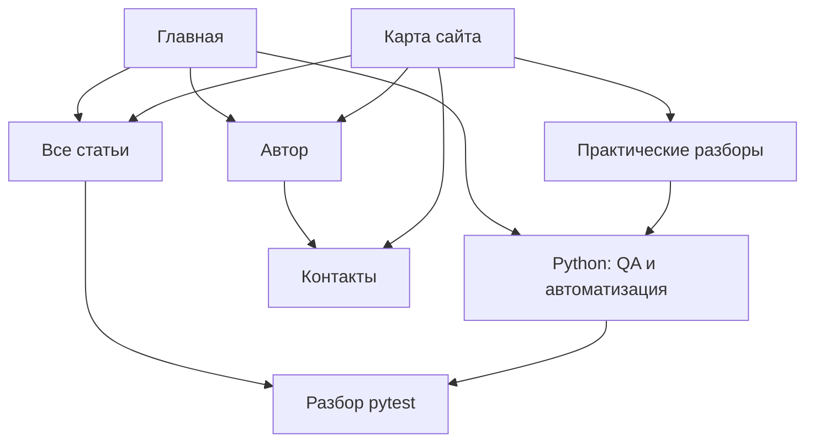

# Структура и страницы блога — 29.10.2026

Статус: предложение ассистента, ожидает решения Дмитрия. Это анализ и проект изменений, не отчет об их реализации.

## Задача и решения пользователя

Запрос: «используя все доступные плагины проведи анализ структуры и твоя цель создать все возможные на сегодня страницы сайта».

Уточнение объема: «Черновики и действующую навигацию». Подготовка страниц и изменение меню разрешены в целом; точная карта ниже предлагается для проверки. Публикация точных версий авторских текстов требует отдельного решения по AGENTS.md.

Основания: принятая миссия v1 в `.author-voice/Миссия проекта 22.10.26.md`, целевая роль из `examples/2026-10-22-mission/review.md`, Python-позиционирование из `examples/2026-10-28-python-positioning/review.md`. Контекст `.agents/product-marketing.md` v1 от 28.10 — черновик, целиком не принят. Миссию и позиционирование эта задача не меняет.

## Что проверено

- Прочитаны все девять Markdown-файлов `content/`, конфигурация, четыре локальных шаблона списков/подборок, workflow GitHub Pages, Netlify, редакционные правила и карта Python-тем.
- `hugo list all`: девять исходных страниц, из них два черновика.
- `hugo --minify --destination .../.tmp/site-audit-production`: код выхода 0, 17 Pages по счетчику Hugo.
- `hugo --buildDrafts --minify --destination .../.tmp/site-audit-drafts`: код выхода 0, 26 Pages. Счетчик включает служебные выходы; это не число статей.
- Обычная сборка: 11 HTML-файлов, включая 404, алиас пагинации и пустые taxonomy-страницы; сборка с черновиками: 16 HTML-файлов.
- Проверка HTML-ссылок обеих сборок: отсутствующих внутренних целевых файлов не найдено; фрагменты-якоря и внешние URL этой проверкой не валидировались. Обход ссылок от главной в обычной сборке достигает только `/`, `/about/`, `/blog/`; docs и таксономии не имеют пути от главной. В draft preview достигается также Python-раздел, статья и демо через sidebar.
- Локально Hugo 0.161.1, тема закреплена на Hextra 0.12.3; оба deploy-конфига указывают Hugo 0.156.0. Новая версия темы не является поручением обновлять ее.
- Через подключенный GitHub подтвержден публичный репозиторий `dshilin/dshilin.github.io`, основная ветка `main`. Это не проверка актуального deploy или совпадения удаленной и локальной версии.
- Веб-инструмент не смог открыть главную `https://dshilin.github.io/`; состояние опубликованного сайта не подтверждено. Документация Hugo/Hextra доступна. Метрик трафика и поискового спроса нет.
- Сборки использовали имеющийся кеш модулей. Попытка сборки с отдельным пустым кешем не смогла скачать Hextra из-за сетевого прокси. Предупреждение Go telemetry о недоступной записи upload.token не помешало успешным сборкам с обычным кешем.

Источники правил платформы: [организация файлов Hextra](https://imfing.github.io/hextra/docs/guide/organize-files/), [черновики Hugo](https://gohugo.io/getting-started/usage/), [build options](https://gohugo.io/content-management/build-options/). Версию документации сопоставлять с закрепленной темой, поведение проверять сборкой.

## Текущая карта

| URL | Состояние в локальной обычной сборке | Решение |
|---|---|---|
| `/` | Главная с двумя направлениями и пустым списком публикаций | Сохранить краткой точкой входа; добавить доступные переходы |
| `/blog/` | Пустой список: единственная статья — черновик | Сохранить URL; включать опубликованные статьи Python в общий каталог без копирования |
| `/about/` | Страница автора | Сохранить текущий текст; не подменять непринятой редакцией из архива |
| `/docs/` | Английская демостраница с Hello World на Go | Подготовить содержательную замену «Практические разборы» |
| `/docs/first-page/` | Demo Page | Исключить из обычной сборки, исходник сохранить |
| `/docs/folder/` | Folder | Исключить из обычной сборки, исходник сохранить |
| `/docs/folder/leaf/` | Leaf Page | Исключить из обычной сборки, исходник сохранить |
| `/docs/python/` | Черновик раздела QA и автоматизации | Сохранить URL и статус, связать с общей картой |
| `/blog/2026-10-26-pytest-shared-list/` | Черновик учебного разбора | Сохранить URL, текст и `draft: true`; не копировать в docs |

Служебные выходы: `/404.html`, `/categories/`, `/tags/`, `/blog/page/1/`, RSS, XML sitemap, поисковые ресурсы. Пустые таксономии пока не дают самостоятельной пользы; не раздувать их в отдельные направления.

## Проблемы и их значение

1. В обычной сборке четыре исходные страницы docs содержат демоматериал. Отсутствие пункта Docs в шапке не исключает их из поиска и XML sitemap.
2. Последние статьи на главной выбираются через `Section == "blog"`, список блога — через его потомков. Будущие публикации из `docs/python` не будут обнаруживаться через эти два входа.
3. Python-раздел пока доступен только при сборке черновиков. Недостаточно убрать `draft` у родительского раздела или поставить его только там: каждому новому тексту нужен собственный `draft: true`.
4. Две карточки тем на главной — обычные div, не ссылки. Создание отдельных пустых направлений не даст им содержательного назначения.
5. В `hugo.yaml` baseURL закомментирован. Локальный sitemap содержит относительные loc. GitHub Pages передает baseURL из configure-pages, Netlify — из DEPLOY_PRIME_URL: проблема опубликованного sitemap не доказана.
6. Нет подтвержденного прямого канала связи. GitHub-профиль известен, но наличие кнопки личных сообщений или публичной почты не установлено.
7. Готовые проекты, авторский вклад и результаты не подтверждены одним наличием репозиториев. Из учебного плана нельзя сделать страницы завершенных кейсов.

## Подходы

**Рекомендуемый: компактные разделы и содержательные черновики.** Сохранить Hugo/Hextra, старые адреса и общую ленту. Создать только страницы с самостоятельной задачей и достаточными источниками. Меню отражает фактически доступные страницы. Это соответствует текущему объему материалов и миссии.

**Альтернатива: отдельные разделы QA, Python, автоматизации, ИИ, инструментов, проектов и личных текстов.** Появится больше посадочных страниц, но сейчас значительная часть будет пустой или повторять Python-вход. Отложить до накопления самостоятельных материалов. Это предложение, а не выбранный пользователем вариант.

Перенос на Sites, смена CMS и массовая генерация поисковых страниц не нужны для этого объема.

## Конкретный объем реализации

Две новые страницы и одна содержательная замена существующей страницы. Два существующих черновика сохраняются. Главная и блог получают только необходимые изменения ссылок и списков. После независимой проверки отдельная страница подхода исключена из ближайшего объема: ее содержание объединяется с `/docs/`.

| Страница | URL | Содержание и источник | Статус до отдельной публикации | Навигация |
|---|---|---|---|---|
| Практические разборы | `/docs/` | Замена демо: зачем я собираю разборы, задача → решение → проверка → ограничения, связь с Python-разделом и общим блогом. Миссия, Python-карта, существующий раздел | Исходник сохранить в архиве; новый текст локально имеет `draft: true`, в обычной сборке `/docs/` временно отсутствует | Раздел в карте; при доступности — ссылка в контексте |
| Контакты | `/contact/` | Интерес к Python QA, Python-автоматизации и ИИ; подтвержденный GitHub; прямой способ связи пока не выбран | `draft: true`; пометка о незавершенном выборе канала — редакционная, убрать до публикации | Шапка только после доступности; ссылка от автора |
| Карта сайта | `/sitemap/` | Автоматический перечень доступных содержательных страниц; отдельно разделы и статьи; без дублирования текстов | `draft: true` до решения о точной версии; в предпросмотре явно помечать черновики | Футер после публикации, в preview доступна для проверки |
| Python: QA и автоматизация | `/docs/python/` | Существующий текст и подборка по career_track | Сохранить `draft: true` | Появляется в preview; в обычном меню только после публикации |
| Два теста, один список | Существующий `/blog/2026-10-26-pytest-shared-list/` | Существующий учебный разбор | Сохранить текст, URL и `draft: true` | Общая лента и Python-подборка при доступности |

Отдельная `/approach/` отложена: при текущем объеме каталога ее функция пересекается с Python-разделом. Формат чтения разборов кратко объяснить в `/docs/`, не публикуя внутренние инструкции.

Для замены `/docs/`: не создавать второй контент с тем же URL. Сохранить исходник и новую версию в архиве; рабочий `content/docs/_index.md` заменить черновиком с собственным `draft: true`. Аналогично исключить три дочерние демостраницы из обычной сборки, сохранив их исходники. Текущий опубликованный сайт не менять: push/deploy не выполняются. Решение о точной публичной версии принимается отдельно. Новые страницы — полноценные Markdown-черновики, не пустые заглушки.

### Предложенные первые абзацы для авторской проверки

Контакты: «Я хочу развиваться в Python QA и автоматизации на Python. Мне также интересно применять искусственный интеллект для автоматизации рабочих задач. Мой профиль и открытые репозитории доступны на GitHub». Не обещать ответ через GitHub и не выдумывать почту или Telegram.

Подход: «В технических разборах я хочу показывать конкретную задачу, выбранное решение и способ его проверки. Отдельно отмечаю, что подтверждает пример и какие вопросы остаются открытыми». Будущие полные тексты сохранять отдельными версиями по README авторского архива.

Практические разборы: «Я собираю здесь материалы о тестировании и автоматизации. В Python-разделе разбираю работу с данными и надежность проверок. В каждой статье обозначаю исходную задачу и ограничения решения». Наличие готовых разборов проверять по доступным страницам; при отсутствии выводить честное пустое состояние.

## Целевая иерархия

```text
/                         Главная
├── /blog/                Общая лента статей
│   └── /blog/2026-10-26-pytest-shared-list/ [черновик]
├── /docs/                Практические разборы [новая версия на проверке]
│   └── /docs/python/     Python: QA и автоматизация [черновик]
├── /about/               Автор
├── /contact/             Контакты [новый черновик]
└── /sitemap/             Карта сайта [новый черновик]
```



Стрелки — целевые связи после публикации соответствующих страниц. В обычной сборке ссылки на черновики отсутствуют; preview показывает их с пометкой статуса.

## Меню и внутренние ссылки

- Целевой порядок шапки: Статьи → Python → Автор → Контакты; далее поиск и GitHub. Существующий адрес `/blog/` сохраняется. Пункты Python/Контакты зависят от наличия страницы в сборке. Не выдавать пункты с пустым URL.
- До публикации новых текстов обычная шапка показывает Статьи/Автор и утилиты. Видимое изменение — метка «Статьи» вместо «Блог», обозначающая общий каталог; новые Python/Контакты пока доступны только в draft preview. Это граница между изменением механизма навигации и публикацией новых текстов.
- Футер: Главная и Автор — доступны сразу локально; Карта сайта — при доступности страницы. Существующую атрибуцию темы сохранить.
- Общий каталог и последние публикации используют одну коллекцию: статьи блога плюс regular pages с `career_track: python`. Удалять дубли, сортировать по дате. Не включать about/contact/approach и страницы разделов.
- RSS `/blog/index.xml` использует ту же коллекцию, что HTML-каталог. Даты, описания и URL едины; Python-материалы не теряются у подписчика. Проверить также исключение черновиков и будущих дат.
- Python-подборка сохраняет существующий career_track и исходные адреса. Взаимные ссылки подбирать по фактической доступности, не через жесткие URL на черновики.
- Для docs сохранить хлебные крошки и неглубокую sidebar-навигацию. Убрать ручные prev/next на демо.
- Демостраницы сохранить как исходники, исключить из обычного результата и всех каталогов/поиска; служебный предпросмотр этих исходников не смешивать с новыми авторскими страницами.
- Не создавать английские версии: явного запроса на синхронизацию нет.

## Какие страницы отложены и почему

| Кандидат | Чего не хватает | Что позволит вернуться |
|---|---|---|
| Проекты / портфолио | Подтвержденного списка проектов и личного вклада | Источники, вклад, проверяемый результат каждого проекта |
| Отдельные кейсы | Проверенного сценария, кода и границ результата | Один полноценный разбор с источниками |
| Python QA отдельно от автоматизации | Достаточного числа различающихся материалов | Несколько готовых статей и разные задачи читателя |
| ИИ-автоматизация | Завершенного материала о конкретной задаче | Воспроизводимый пример и вклад автора |
| Группировка результатов / генераторы | Подтвержденного текущего прогресса и авторства; генераторное задание отмечено незавершенным | Актуальные исходники и результаты, без раскрытия самостоятельного задания |
| Личные размышления как раздел | Готового выбранного авторского текста в content | Точная версия с решением автора |
| Резюме / условия работы | Проверенной актуальной версии, роли, географии, условий | Отдельно предоставленное актуальное резюме |
| Глоссарий / сравнения / справочник | Данных, уникальной пользы каждой страницы и исследования спроса | Малый проверенный набор по programmatic-seo |
| Архив по годам, отдельные категории | Объема публикаций, оправдывающего дополнительную навигацию | Рост каталога; обычная лента пока решает задачу |
| Услуги / цены / отзывы | Поручения создавать коммерческий сайт и подтвержденных данных | Отдельное решение и источники |
| Privacy / terms / cookies | Аудита фактической обработки данных и правовых требований | Отдельная задача по реальному функционалу; юридические обещания не выдумывать |
| Newsletter / форма обратной связи | Канала, сервиса, обработки данных и подтвержденного процесса | Отдельное решение о функционале |

«Все возможные» здесь означает все обоснованные текущими материалами страницы. Матрица не ограничивает развитие после появления источников. Поисковый спрос и выдача по новым темам не исследованы; SEO-эффект не обещается.

## Инструменты и плагины

- Site-architecture: карта, URL, меню, ссылки. Content-strategy: самостоятельная польза и готовность материала. Product-marketing: сверка с существующим черновым контекстом, без пересмотра миссии.
- GitHub: подтверждение репозитория. Локальный Hugo и исходники: инвентаризация и сборки. Веб: первичная документация и попытка проверки опубликованной главной.
- Sites: изучен workflow; существующий Hugo/GitHub Pages не требует регистрации другого сайта или переноса хостинга. Canva/ImageGen не требуются для этой структуры.
- Gmail, Calendar, Contacts, Drive, Pets и остальные сервисы не содержат необходимых для этой задачи данных по предоставленному контексту; обращения к личным данным и изменения внешних сервисов ради формального использования всех плагинов не выполняются.
- Programmatic-seo не запускается: массовую серию без доказательной базы и самостоятельной пользы не проектируем. Наличие навыка не разрешает генерацию пустых страниц.

## Ограничения исполнения

Не менять непринятый контекст позиционирования, миссию и существующие авторские статьи. Не публиковать, не push и не менять deployment в этой задаче без отдельного решения. Нынешние пользовательские изменения AGENTS.md, редакционных шаблонов и workflow, а также незакоммиченные файлы content-strategy сохранять; не включать автоматически в собственный коммит.

Технические решения о версиях Hugo, baseURL и таксономиях перечислены как риски и отдельные задачи. Они не входят автоматически в создание страниц.

## Приемка реализации

1. Созданы полноценные новые черновики, архив версий и review.md со статусом «ожидает проверки». Контактный пробел указан редакционно; страница не объявлена готовой к публикации.
2. Обычная сборка и draft preview проходят на доступной локальной версии; совместимость с CI 0.156.0 проверена отдельно либо явно остается непроверенной.
3. Проверены URL, меню, sitemap, поисковые ресурсы: нет ссылок на отсутствующие страницы, демоматериал не доступен в обычной сборке, черновики туда не попадают.
4. На временных материалах проверено попадание статьи из docs/python в общий каталог и последние публикации; исключение draft/future, отсутствие дубля существующего pytest-поста. После проверки временные материалы удалены.
5. Выполнена визуальная проверка шапки, футера, каталога и новых страниц на узком и широком экране; если недоступна, ограничение явно указано.
6. Diff проверен отдельно от пользовательских изменений. Сохранение в Git — только файлов согласованного объема; push и публикация отдельно.

## Решение, необходимое перед реализацией

Подтвердить рекомендуемую карту: две новые страницы (контакты и карта), новая версия docs, условное меню и ссылки футера, общий HTML/RSS-каталог и исключение демо. Разрешение на публикацию этим подтверждением не подразумевается. До решения создан только этот проект; продуктовые исходники не менялись.

Независимая проверка: исправлены четыре вопроса — судьба `/docs/` до публикации, дублирование страницы подхода, состав RSS и видимые изменения обычного меню. Публичная биография и текст pytest не редактируются. Остальные решения о шаблонах и механизме условных пунктов оставлены исполнителю с обязательной проверкой обеих сборок.
